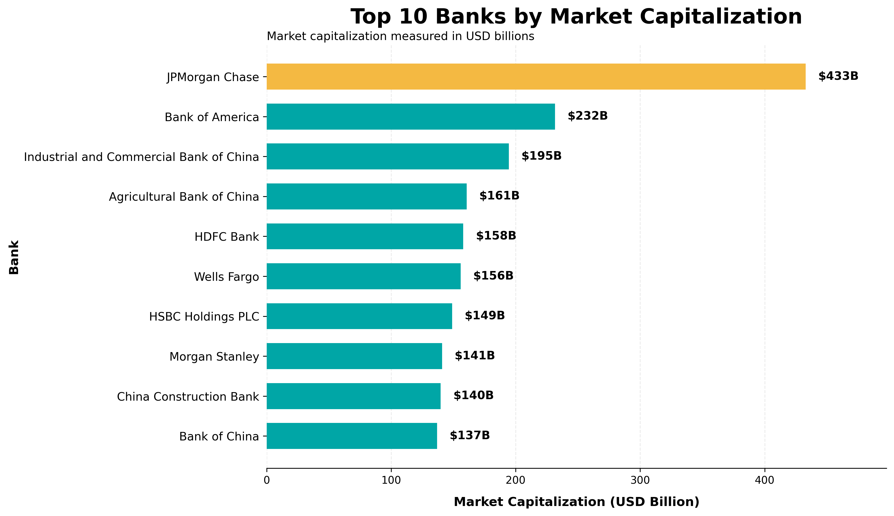

# Banks ETL Project

A Python-based ETL project that extracts the top 10 largest banks
by market capitalization, transforms the values into GBP, EUR,
and INR, and loads the processed data into CSV and SQLite.

## Project Overview

This project demonstrates a basic ETL pipeline:

1. Extract bank data from a web page.
2. Transform market capitalization using exchange rates.
3. Load the transformed data into a CSV file.
4. Load the data into an SQLite database.
5. Run SQL queries on the database.
6. Log the progress of the ETL process.

## ETL Pipeline

Web Source
    ↓
Extract
    ↓
Transform
    ↓
CSV + SQLite
    ↓
SQL Queries

## Technologies Used

- Python
- Pandas
- Requests
- BeautifulSoup
- SQLite
- SQL
- Jupyter Notebook

## Data

The project uses the following input data:

- Bank market capitalization data
- Currency exchange rates from `exchange_rate.csv`

The market capitalization is originally provided in
USD billions.

It is converted into:

- GBP billions
- EUR billions
- INR billions

## Visualization

The chart below shows the top 10 banks by market capitalization:



## Project Structure

```text
Banks-ETL-Project/
│
├── banks_project.py
├── exchange_rate.csv
├── Largest_banks_data.csv
├── banks_etl_project.ipynb
├── README.md
└── .gitignore
